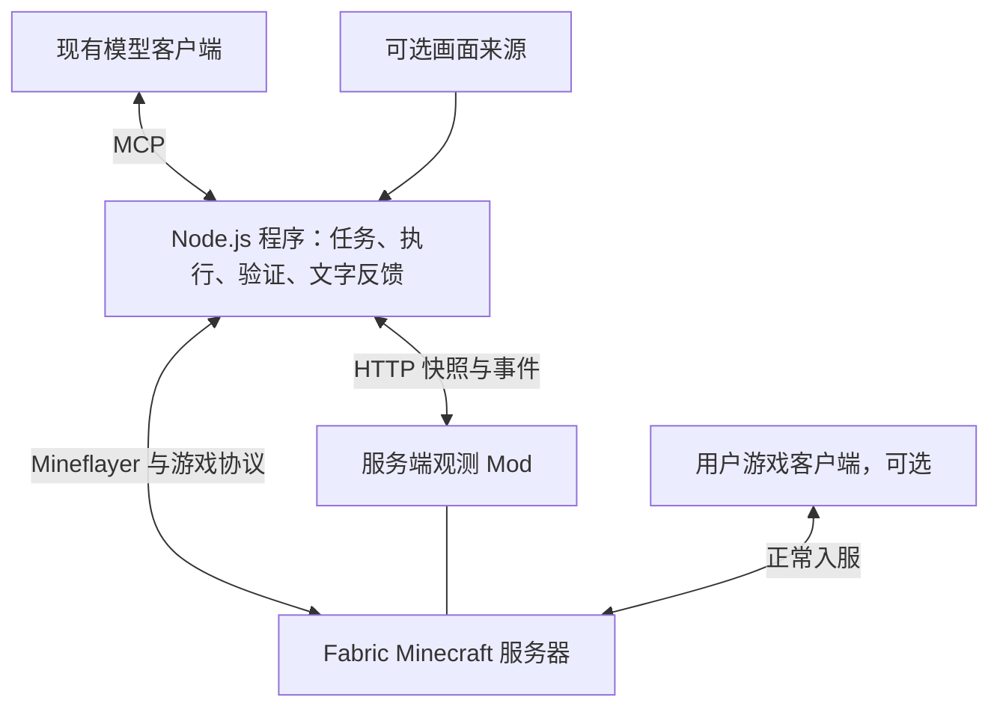

# Minecraft MCP 总体设计

本文固化项目的实现路线、核心机制和行为边界，作为后续开发依据。目录分层和抽象顺序见 [仓库分层与抽象路线](minecraft-layering.md)。文中的场景用于解释设计，不构成必须逐项实现的动作清单，也不规定类名或函数名。

状态：架构设计已确定；游戏版本组合、第三方行为和实际性能仍须通过接入实验验证。文中“必须”表示实现约束，“可选”表示有明确边界的扩展能力。

## 1. 项目定位

本项目把实时 Minecraft 世界转换为适合模型进行高层规划的、以文字和结构化语义为主要反馈的操作环境。模型声明意图、约束和完成条件，程序承担实时控制、持续观测、结果验证及可恢复的任务执行。

继承 agent-gavel 的核心机制：**动作与预期效果共同声明，执行结果由程序根据证据判定，无法确定时明确返回不确定。** 在游戏中进一步增加执行前的可行性判断、执行中的持续条件，以及多动作之间的条件依赖。

离散化的是模型的决策过程。游戏世界、角色运动和风险保持实时运行；模型思考和工具请求结束都不暂停游戏。模型主要在目标选择、方法选择、约束变化和无法程序化的判断处介入。

文本优先不等于把整个世界压成自然语言。精确几何和实时状态保留在程序中；文字摘要面向当前决策，结构化数据承担对象引用、约束和证据。不得把摘要重新当作底层事实来源。

## 2. 确定的实现路线

| 事项 | 确定方案 |
|---|---|
| 游戏与控制对象 | Minecraft Java 版，首版控制一个独立入服的机器人玩家 |
| 项目形态 | 独立仓库；复用 agent-gavel 的思想，首版不嵌入其 Python DOM/桌面运行路径 |
| 主程序 | TypeScript/Node.js；MCP 接口与常驻执行逻辑在同一进程、不同模块 |
| 模型入口 | MCP；使用现有 MCP 客户端中的模型，不另建一套模型代理 |
| 玩家控制 | Mineflayer 作为直接依赖，首版不 fork |
| 路径能力 | 使用 mineflayer-pathfinder，并由本项目限定移动方式和世界修改范围 |
| 完整观测后端 | 自研 Java/Fabric 服务端 Mod，提供额外世界信息、事件和区域标记 |
| 服务端通信 | HTTP 局部快照查询与带游标的事件长轮询；不在 Mod 内再实现 MCP |
| 初始部署 | 独立 Fabric 游戏服务器与 Node.js 程序；用户客户端可选，用于观看 |
| Voyager | 参考控制原语、观测组织和技能复用；单独作为可选实验基线，不作产品运行依赖 |
| 视觉 | 可选 prismarine-viewer 做结构预览；实际渲染需求由独立客户端画面适配补充 |

MCP 是接口协议，独立程序是运行形态，两者同时成立。Fabric 服务端 Mod 是主程序的信息来源之一，不承担模型规划或机器人主控制。

完整模式使用服务端 Mod；基础模式允许只用 Mineflayer，但必须公开观测范围和可验证程度，拒绝需要缺失能力的任务。两种模式采用相同任务语义，不能在基础模式中偷偷降低成功标准。

首版 Mod 不新增游戏内容，也不要求机器人实现自定义客户端握手；具体兼容性仍须验证。Paper 插件是未来替换服务端观测后端的路线，首版只维护 Fabric。接管用户当前客户端角色是另一种控制后端，需单独设计接入；不作为本版能力暗含支持。

## 3. 两个参考项目如何使用

### 3.1 Mineflayer：直接复用控制与客户端状态

复用连接、协议、方块与实体信息、物品交互和玩家操作；路径执行复用 pathfinder。本项目负责目标解析、允许范围、条件检查、持续监测、验证和恢复。

第三方 API 或插件必须经过本项目控制入口使用。路径行为可能包含挖掘、搭建等副作用，因此移动许可和修改许可分别确定。战斗、采集等插件逐项验证控制占用、取消和结果含义后才能组合使用。

库函数返回不等同于任务成功。已阅读的 Mineflayer 挖掘实现包含本地预测更新；实体离开跟踪也不能单独证明死亡。适配层必须说明事件来源和含义，上层验证按具体证据判断。[Mineflayer](https://github.com/PrismarineJS/mineflayer)、[挖掘源码](https://github.com/PrismarineJS/mineflayer/blob/4fb62af5f8807adbf0c76c3d91221be246f40e8b/lib/plugins/digging.js)、[pathfinder](https://github.com/PrismarineJS/mineflayer-pathfinder)

### 3.2 Voyager：参考方法和技能积累

参考其动作组合、观测整理、环境反馈和技能保存方式。适用思路移入本项目时，补足执行条件、效果证据和退出方式，并保留代码许可与来源。

Voyager 的模型代理、自动课程、critic 和 Python—Node.js 桥接不进入首版运行路径。模型已由 MCP 客户端提供，确定性验证由本项目实现；语义与审美评审仍由模型承担。

Voyager 的实验环境有步骤间暂停等安排，其安装说明列出暂停服务器的 Mod。因此参考其代码时必须识别实验假设，不能把暂停、传送或补物品能力变成正常生存操作的隐含条件。复现实验单独建立匹配环境。[环境桥接](https://github.com/MineDojo/Voyager/blob/55e45a880755d0c8c66ca7fb5fe7962ac8974f89/voyager/env/bridge.py)、[技能管理](https://github.com/MineDojo/Voyager/blob/55e45a880755d0c8c66ca7fb5fe7962ac8974f89/voyager/agents/skill.py)、[实验 Mod](https://github.com/MineDojo/Voyager/blob/55e45a880755d0c8c66ca7fb5fe7962ac8974f89/installation/fabric_mods_install.md)

## 4. 核心机制：三个不同速度的闭环

总体循环为：**观察世界 → 建立事实和关系 → 生成可行选择 → 展开任务 → 闭环执行 → 验证效果 → 更新事实与剩余任务。**

| 闭环 | 负责内容 | 主要执行者 |
|---|---|---|
| 即时控制 | 瞄准修正、运动反馈、交互时机、落地和及时退出 | 本地控制器 |
| 任务执行 | 条件衔接、选择可行站位、进度、局部修复和恢复 | 本地执行程序 |
| 高层决策 | 目标、方法、路线取舍、资源投入、风险及语义判断 | 模型 |

前两个闭环持续运行，不等待模型逐次发指令。模型提交的任务必须有限定范围、预算和退出策略；程序只能在这些边界内自主调整。

即时控制和任务执行使用同一套已确认事实。规划可以推演未来效果，但推演结果不得进入事实层。例如可以根据计划中的桥面推演后续路线，不能在实际确认前让角色站上去。

## 5. 世界表示：从事实到可执行关系

### 5.1 三种内容分开保存

| 内容 | 例子 | 用途 |
|---|---|---|
| 可观测事实 | 方块及属性、碰撞、位置和速度、生命值、背包、实体事件 | 控制与验证依据 |
| 计算得到的关系 | 可站立、可达、可交互、连通、遮挡、支撑、可撤退 | 判断动作能否进行及选择执行方案 |
| 语义对象与标签 | 树、建筑、房间、入口、施工区、保护区 | 目标表达、检索和任务规划 |

所有结论保留来源、时间和适用范围；推断保留依据，未知和过期独立表达。不能把客户端预测标成服务端确认，不能把推断标签标成游戏原生事实。

对象引用必须能区分世界、维度、当前会话和具体目标。实体重新出现、跨维度、重连、容器窗口变化后，旧引用不能无条件继续使用。世界方向与角色相对方向分开，坐标和姿态约定统一。

世界状态同时包含静态与动态信息。仅有体素地图无法判断带速度的跳跃，也不足以处理运动目标战斗。几何使用实际碰撞形状，不能把半砖、楼梯、门等统一当完整立方体。

### 5.2 可执行关系是连接观测和动作的中间层

任务不能只得到“这里有一个方块”，还要得到“现在可以从哪里、以什么方式操作它”。例如施工方案需要同时确定可达站位、交互面、目标位置、材料和预期状态。

关系计算在任务相关区域内展开。候选方案检查目标有效性、几何、通路、材料、姿态及允许的副作用；不成立时返回具体缺失条件。缺少事实时先观察，不能把缺少结果直接解释为无路或不可行。

每个关系保留对事实的依赖。站位支撑消失会使相关施工方案失效；远处无关方块变化不必让全部任务重算。关系更新、任务中断和局部恢复使用同一套依赖信息。

### 5.3 结构与连通目标的边界

特权信息可以提供方块和游戏生成结构等数据，但不会自动给任意玩家建筑赋予可靠用途和边界。标签来源依次支持人工标记、已有蓝图、服务端元数据和后续识别算法。

包围盒用于粗定位，部件或精确成员用于施工与拆除。同一长方体内可能包含地形、其他结构或地下空间，不能仅凭包围盒决定破坏范围。

针对相连目标，必须明确邻接规则、种类过滤、搜索边界、数量上限和保护范围。先形成有界工作集合，再执行并复验；不随执行中新增连接无限扩大。采集方块与获得掉落物是不同结果，应分别检查。

## 6. 动作的统一语义

原语对应可独立解释和验证的效果，可以包含多次底层输入。原语不要求等于一次按键；拆分依据是局部控制是否可以自主完成，以及哪里需要重新选择目标、方法或资源投入。

每个可复用行为必须说明以下内容，具体表示方式由后续实现确定：

| 内容 | 必须明确的问题 |
|---|---|
| 意图与目标 | 操作谁，期望改变什么，范围在哪里 |
| 开始条件 | 哪些事实与能力必须满足，未知时怎么办 |
| 持续条件 | 哪些条件在什么执行阶段必须成立 |
| 局部执行 | 怎样利用实时反馈调整操作 |
| 完成判据 | 具体效果、时限和证据要求是什么 |
| 副作用与预算 | 允许改变、消耗和占用什么，最多多少 |
| 退出与恢复 | 如何停止，如何核对已发生效果，何时可以继续 |

底层行为带有不可被调用者删除的基本判据；上层可以增加条件、收紧范围，不能通过省略断言把已发出操作当成完成。相同约束从目标传递到所有子步骤，子步骤不能自行扩大修改范围或预算。

优先表达期望状态，减少“切换一次”在重试时产生的歧义。一次请求重复到达不能触发第二次独立操作。超时后先核对实际效果，再决定是否重试；不承诺跨游戏服务器的普遍恰好执行一次。

连续移动、跟随、姿态保持和守卫等行为也必须有期限、停止条件或会话范围。“已启动”与“已完成”分别报告。

## 7. 执行和验证分别表达

任务是否正在运行、已中断或已超时，与目标是否满足是不同信息。结果同时报告执行情况、目标效果、过程中约束是否被违反，以及效果归因是否明确。

验证沿用 agent-gavel 的三态：满足、明确不满足、不确定。运行期间尚未达成不自动判为最终失败；失去观测、证据不新鲜或来源不足时不能判满足。

必须区分以下事实：

- 输入已发送、动画发生、命中目标、造成伤害。
- 目标方块消失、掉落物产生、物品实际入包。
- 目标实体死亡、实体移出跟踪范围。
- 客户端状态变化、服务端状态确认。
- 目标状态已达成、本次操作造成该状态。

库存变化等可以作为辅助证据，但不普遍代替目标状态检查。所需证据由行为含义决定；后端不能提供时明确报告能力不足或结果不确定。

过程约束需要持续证据。事件中断或观测缺口不能靠最后读一次状态补成“全程满足”。即使全部子步骤曾成功，组合结束仍要检查整体目标，因为早先的效果可能被环境改变。

返回信息必须包含已完成、未尝试和结果不明的部分、相关资源变化、阻断原因及必要证据。使用简短结论加可展开细节，避免每步回传全世界状态。

## 8. 组合与自主执行

高层目标通过已知方法展开为子目标及其条件依赖。执行器选择前提已满足的部分推进；缺条件时寻找在既定范围内能建立条件的方法；条件未知时先补观察。

例如建造需要材料和可达施工位置，施工产生的新表面又可以成为后续站位。模型选择总体方法和代价，程序完成局部几何、已知配方、施工顺序和执行检查。

组合允许顺序、条件分支和有界重复，并保留未来增加更复杂依赖的空间。首版不要求自动发现任意任务的完整计划，也不执行模型临时生成的任意代码。新增方法先作为候选，经验证后进入可复用库，并保存适用条件和版本。

自主处理遵守三个层次：

1. 同一动作内的小偏差由局部反馈修正。
2. 同一目标和约束内的变化由任务层局部重规划。
3. 需要改变目标、范围、方法或资源投入时交回模型。

恢复以当前世界为准，重新核对仍成立的子目标，从缺失部分继续。不得简单从头重放，也不能只按上次步骤编号继续。已消耗物品和已修改世界是实际进度，失败不意味着回滚。

## 9. 实时监测、控制协调与中断

开始前检查与执行中监测共同工作。前置检查决定能否开始，持续监测决定能否继续，退出机制决定停止时怎样处理角色和已发出的操作。

威胁检查结合实体、遮挡、攻击通路、运动、投射物和退出时间；不能只依赖固定半径内敌人数。施工检查覆盖站位支撑、净空、液体、重力影响、实体占位、材料、施工通路和退路。平整检查只服务于确实要求平整的任务。

观察范围和新鲜度不足时降低自主执行范围，必要时暂停推进。附近没有检测到威胁只能说明观测范围内的当前结论，不能保证未来不会受击。

第一版一个机器人只有一个负责修改和控制的执行分支，观察与监测并行。涉及移动、视角、手持物品和界面的组合必须由同一分支协调，避免建筑、寻路和战斗同时争抢控制。

中断按行为处理：停止新步骤、核对在途交互、完成适用的落地或退出过程、释放控制，再交接。旧行为的迟到回调不得重新夺取控制。第三方控制器必须验证停止行为后才能组合。

模型思考、MCP 等待结束和模型客户端失联都不会暂停世界。运行期间采用事先声明的待机或有限应急策略。初版主进程退出后不承诺机器人仍自主运行；断线、崩溃和重连后先核对效果，不自动重放未确认操作。

## 10. 不同玩法如何组合

| 场景 | 模型重点决定 | 程序重点承担 | 组合边界 |
|---|---|---|---|
| 寻路与探索 | 目的区域、允许代价、是否改造地形 | 路径与通行检查、局部重规划、覆盖范围 | 需要新修改权限或进入未知风险区域时重新决策 |
| 跑酷与复杂移动 | 路线和可接受风险 | 运动状态、起跳与落地控制、稳定点检查 | 运动能力超出验证范围时退出或改路 |
| 建筑 | 蓝图含义、选址、材料和修改范围 | 地形与施工站位、顺序、放置及整体验收 | 外部修改冲突、材料不足或风险变化 |
| 战斗 | 目标、装备策略、撤退条件 | 跟踪、距离、时机、防御和威胁响应 | 新威胁或策略失效时退出或重新决策 |
| 物品、容器与生产 | 资源分配、产出目标、优先级 | 合法交互、材料变化、制作与加工进度 | 新资源需求或生产条件失效 |
| 农作、养殖与运输 | 工作范围、对象和周期目标 | 对象状态、交互条件、周期等待、乘载和移动关系 | 对象、环境或可行路线变化 |

这些场景共享观测、条件、效果、中断和组合机制，不能分别建设互不兼容的子系统。寻路可以成为建筑的子过程，移动可以成为战斗的子过程；跨场景副作用都计入同一任务范围。

## 11. 特权信息的边界

服务端 Mod 提供有界世界快照、可取得的实体与伤害等事件，以及区域标记持久化。世界读取在游戏线程或由其生成快照完成；HTTP 等待和重计算不得阻塞游戏线程。任务规划、关系推导和动作组合放在 Node.js。

额外观测权限与额外修改权限分开。主路线通过正常玩家协议执行行为；传送、给物品和直接编辑世界若用于实验，必须作为单独实验能力和评价条件。

服务端快照也需要时间、范围和身份对齐，不能天然当作跨所有来源的同时状态。未加载区域先返回未知，加载远处区块需要显式能力。服务端位置或死亡事件不自动证明本次操作的因果归属。

区域标签保留创建来源和边界；识别置信不足时提供候选和歧义。算法标签只帮助选择目标，不能自动扩张允许修改范围。

## 12. 视觉反馈何时介入

结构化数据足以确定操作和验证时，持续使用文字与结构化反馈。视觉用于任务所依赖的信息尚未被可用数据表达的情况：审美和构图、参考图匹配、自定义界面与视觉内容、复杂语义识别、渲染异常。

升级过程为：找出阻断决策的问题 → 尝试局部事实和几何查询 → 判断画面能否提供缺失信息 → 按需取得画面 → 将视觉结论关联到具体对象或目标。

不确定结果不会自动触发截图。服务器确认不足需要补证据，材料不足需要策略选择，都未必需要视觉。战斗实时性高也不等于必须让模型逐帧看画面。

图像附带时间、视点、目标和来源。第三方 viewer 用于结构预览；实际材质、光照、界面或模组表现要求真实客户端画面。连续动作诊断可能需要轨迹或连续帧，不能只依赖静态截图。视觉结论不覆盖确定的游戏状态证据。[prismarine-viewer](https://github.com/PrismarineJS/prismarine-viewer)

## 13. 贯穿场景：采集材料并建造通路

1. 将用户目标解释为连接区域、通行要求、材料与禁止修改范围；会改变任务含义的歧义先澄清。
2. 建立任务相关世界事实，计算可达区域、施工关系和材料来源；语义不明的结构保留未知。
3. 模型选择总体方法；程序按前提和效果展开材料准备与施工过程。
4. 采集按有界目标执行，分别核对目标变化和物品获得；施工每一步验证实际状态后更新可行站位。
5. 局部站位变化在既定范围内修复；威胁进入时中断施工并执行已约定退出，不等待模型反应。
6. 上报已完成部分、资源、失效条件及需要选择的问题；继续时重新核对实际世界。
7. 最终检查整个连接和附加要求。几何通路成立与已经实际通过分别验证，按任务要求采用。

这个场景检验同一机制能否跨采集、制作、移动、施工与避险运行。它用于验收架构，不把该场景写死为核心模型。

## 14. 验证与演进原则

先验证后端事实，再建立统一语义；先把局部闭环跑可靠，再提取组合；先用人工对象边界证明机制，再扩展自动结构识别。具体分层顺序见配套文档。

验证必须包含环境干扰，而非仅验证一次顺利完成。代表性问题包括服务器拒绝、本地预测回滚、目标改变、实体离开跟踪、材料不足、危险进入、观测中断、重复请求和执行中断后的恢复。

关注完成率之外的误判成功、非预期修改、中断响应、恢复能力、模型往返与视觉调用。测试使用可复位环境；录制事件适合重现判定，真实服务器用于验证协议与控制行为。

架构选型保持稳定；游戏和依赖版本、可用证据等级、动作适用范围及控制时限通过实验形成明确的兼容性记录。新增能力优先扩展事实关系、局部控制和任务方法，只有跨层语义发生变化才调整核心协议。
